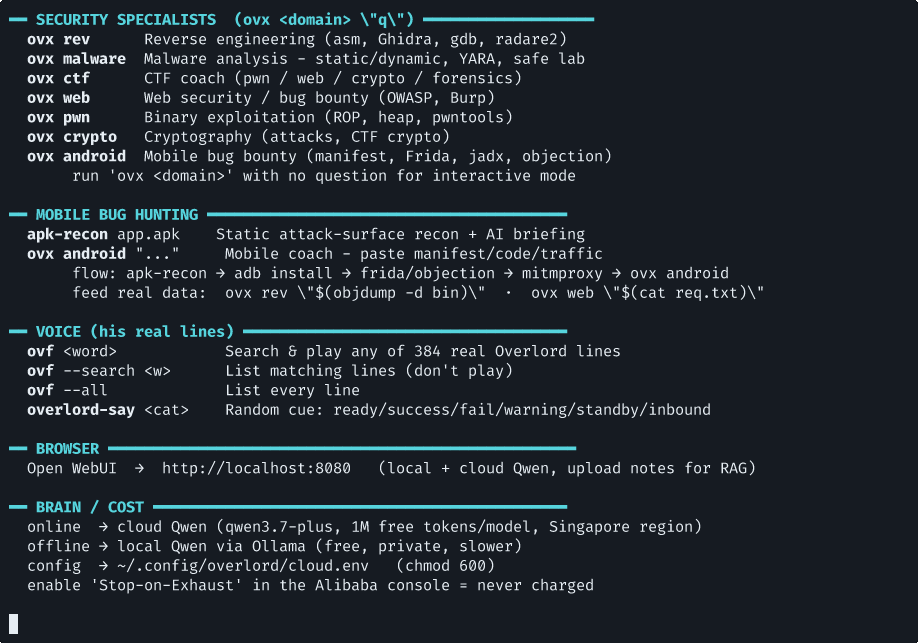
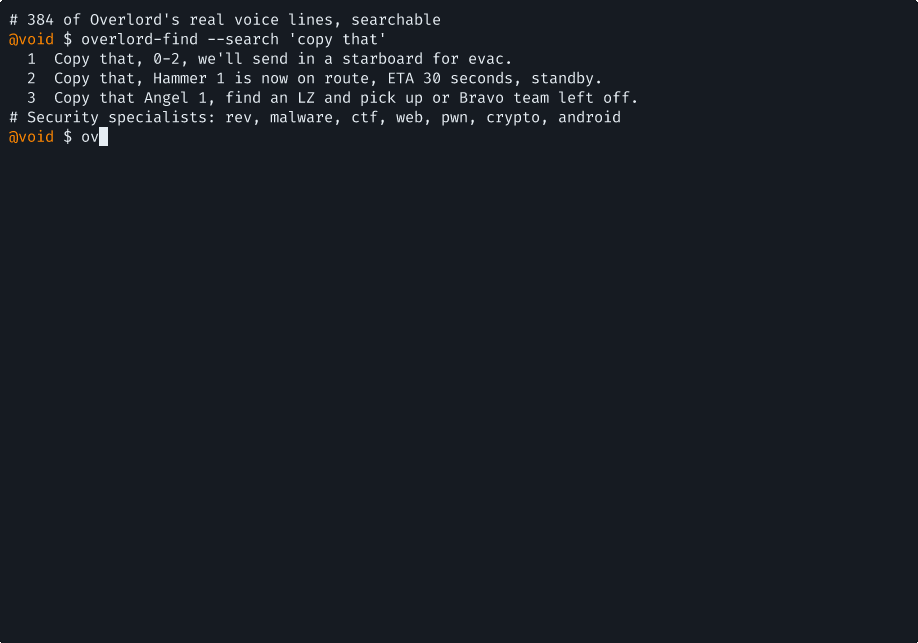

# Overlord

Local and cloud AI agents for the terminal, with a voice layer built from your own audio clips. A study buddy, a confirm-before-run system operator, and a set of security specialists (reverse engineering, malware analysis, CTF, web, pwn, crypto, Android bug bounty), all powered by local Qwen when offline and a fast cloud model when online.


> Built as a personal project. The brain is [Ollama](https://ollama.com) locally and any OpenAI-compatible API in the cloud. The voice is optional and uses your own audio.

## What it does

| Command | Role |
|---------|------|
| `overlord "q"` (`ov`) | Study and chat agent |
| `overlord-sys "task"` (`ovs`) | System agent: proposes a shell command, you approve, it runs |
| `overlord-code` (`ovc`) | Coding agent ([Aider](https://aider.chat)) |
| `ovx <domain> "q"` | Security specialists: `rev` `malware` `ctf` `web` `pwn` `crypto` `android` |
| `apk-recon app.apk` | Android static recon, then an AI attack-surface briefing |
| `overlord-find <word>` (`ovf`) | Search and play any voice line |
| `overlord-say <category>` | Random voice cue (ready/success/fail/warning) |
| `overlord-help` (`ovh`) | Full reference |

The agents try the cloud model first (fast) and fall back to local Qwen automatically when offline, so everything works on a plane.

## Screenshots

**Full command reference (`ovh`):**



**Searchable voice library (384 lines in this build):**



## Install

```bash
git clone https://github.com/JackSessions/overlord-agents.git
cd overlord-agents
./install.sh
```

Requirements:
- [Ollama](https://ollama.com) plus a model: `ollama pull qwen2.5-coder:3b`
- `jq`, `ffmpeg`, `curl`
- Optional cloud brain: edit `~/.config/overlord/cloud.env` (see `cloud.env.example`). Works with Qwen/DashScope, Groq, Gemini (OpenAI mode), OpenRouter, and others.
- Optional coding agent: `uv tool install aider-chat`
- Optional voice: `uv tool install whisper-ctranslate2`, then provide your own audio

## Voice (bring your own audio)

This repo ships no audio. Voice lines are built from clips you supply and have the right to use:

```bash
./voice/setup-voice.sh /path/to/your-own-audio.mp3
```

It transcribes with Whisper, slices the speech into a searchable labelled library, and wires it into the agents. Do not use copyrighted audio you do not have the rights to.

## Security and cost notes

- Your API key lives only in `~/.config/overlord/cloud.env` (git-ignored). Never commit it.
- `overlord-sys` always shows the command and waits for your approval before running anything. A small local model can get commands wrong, so you stay in control.
- Cloud APIs are pay-per-token; most have a free tier. Set a spending cap in your provider's console.
- The security specialists are for authorized testing, CTFs, and learning only.

## License

MIT (code). Audio, model weights, and API usage are your own responsibility.
